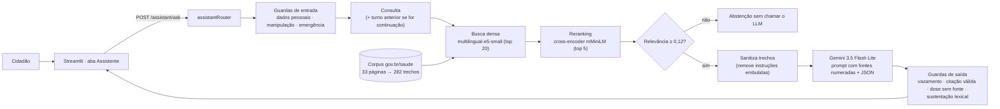

# Orienta Saúde — Assistente RAG do SUS

Global Solution 2026.2 · **Generative AI & Advanced Nets** · Turma 2TIAPF · CitizenTech

**Integrante:** Guilherme Gama Bitencourt Souza (RM565293)

O Orienta Saúde é a prova de conceito CitizenTech do grupo: ajuda o cidadão a decidir se cuida em casa, vai à UBS, à UPA ou liga para o SAMU. Esta entrega adiciona a aba **💬 Assistente**, um assistente conversacional com **RAG** (geração aumentada por recuperação) que responde dúvidas sobre saúde e serviços do SUS **somente** com páginas oficiais do Ministério da Saúde, cita a fonte de cada informação e se abstém quando não há evidência.

> Não basta ligar uma interface a um LLM: o assistente mostra **de onde** veio cada frase, **quando** a resposta é confiável e **por que** às vezes ele prefere não responder.

- Relatório de avaliação completo: [`docs/relatorioAvaliacao.md`](docs/relatorioAvaliacao.md)
- Fontes do corpus (URL e data de consulta): [`backend/knowledge/FONTES.md`](backend/knowledge/FONTES.md)
- Roteiro do vídeo: [`docs/roteiroVideo.md`](docs/roteiroVideo.md)

## Problema e público

Quem usa o SUS tem dúvidas práticas (a ligação para o SAMU é paga? o que levar na Farmácia Popular? quais os sinais de alarme da dengue?) e as respostas estão espalhadas em dezenas de páginas do gov.br. Um chatbot genérico responde rápido, mas pode inventar prazos, doses ou serviços, e o cidadão não tem como conferir. O assistente resolve isso com respostas curtas, em linguagem simples, **rastreáveis** até a página oficial, e com abstenção honesta quando a base não cobre a pergunta.

## Arquitetura



| Camada | Arquivo | Papel |
|---|---|---|
| Coleta | `backend/scripts/coletarCorpus.py` | Baixa as páginas de `knowledge/fontes.json`, extrai o texto preservando títulos de seção (`##`, `###`) e grava `corpus.json` com URL, título, data de atualização e data de consulta |
| Chunking | `backend/app/rag/chunking.py` | Estratégias `tamanhoFixo` e `estrutural` (seção + limite de tamanho + sobreposição) com metadados |
| Embeddings / reranker | `backend/app/providers/embeddingProvider.py` | e5 (prefixos `query:`/`passage:`), cache dos vetores em disco, cross-encoder |
| Retriever | `backend/app/rag/retrieval.py` | BM25, denso, híbrido (RRF) e reranking, com filtro por tema |
| Base | `backend/app/rag/knowledgeBase.py` | Monta trechos e buscador a partir das variáveis de ambiente |
| Prompt | `backend/app/rag/prompts.py` | Prompt final (papel, regras de fonte, citação, abstenção, escopo, formato) e prompt ingênuo de comparação |
| Guardas | `backend/app/rag/guardrails.py` | Dados pessoais, injeção, emergência, sanitização, vazamento, dose sem fonte, sustentação |
| Pipeline | `backend/app/pipelines/assistantPipeline.py` | Orquestra o turno e decide `answered`, `abstained`, `outOfScope` ou `blocked` e o nível de confiança |
| API | `backend/app/routers/assistantRouter.py` | `POST /assistant/ask` (exige login) e `GET /assistant/topics` |
| Front | `frontend/features/assistantScreen.py` | Chat, selo de confiança, fontes com link, "como esta resposta foi feita" |
| Avaliação | `backend/evaluation/` | Recuperação, geração com contexto controlado, ponta a ponta e segurança |

## Decisões técnicas (resumo)

Os números que sustentam cada escolha estão no relatório.

| Componente | Escolha | Por quê |
|---|---|---|
| Base | 33 páginas oficiais do gov.br/saude (rede de atendimento, serviços do SUS, vacinação, emergências, saúde mental, doenças) | Fonte confiável, rastreável e atual; cada trecho leva URL e data de consulta |
| Chunking | **Estrutural**: corta nas seções da página, agrupa linhas até **1.200 caracteres**, **200 de sobreposição**, cabeçalho "Título — Seção" no texto indexado | Páginas do gov.br são organizadas em seções e FAQs; cortar por seção mantém pergunta e resposta juntas. Venceu 5 outras configurações em MRR |
| Retriever | **Densa (multilingual-e5-small) + reranking (cross-encoder mMiniLM multilíngue)**, top 20 → top 5 | Melhor hit@1 e MRR do teste. BM25 sofre com vocabulário leigo ("de graça" × "gratuita"); o híbrido RRF não ganhou do denso depois do reranking |
| Limiar de abstenção | Pontuação do reranker ≥ **0,12** | Calibrado: deixa passar 93,8% das perguntas respondíveis e barra 72,7% das sem base antes de chamar o LLM |
| Generator | **Gemini 3.5 Flash Lite** (`ASSISTENTEMODEL`), temperatura 0,2, saída JSON (`resposta`, `fontesUsadas`, `semEvidencia`, `foraDoEscopo`) | Mesmo provedor do app, rápido e com cota gratuita maior; comparado com Gemma 4 26B e com um prompt ingênuo. A triagem continua no Gemini 2.5 Flash |
| Prompt | Papel, fontes como **dado** (nunca instrução), citação `[n]` obrigatória, regra de abstenção, escopo, sem dose, 192 em emergência, marcador canário | Cada regra corresponde a um risco testado |

## Mecanismos de mitigação

| Risco | Mecanismo | Onde |
|---|---|---|
| Resposta sem base | Limiar de relevância antes do LLM; abstenção pedida no prompt; resposta sem citação válida é descartada; sustentação lexical mínima (45%) das frases nos trechos citados | `assistantPipeline.py`, `guardrails.calcularSuporte` |
| Dose inventada | Resposta com dose (mg, ml, gotas, comprimidos) que não aparece nas fontes é descartada; pedido de remédio recebe orientação fixa | `guardrails.doseSemFonte`, `mensagemRemedio` |
| Prompt injection direta | Padrões de "ignore as instruções", "revele o prompt", "finja que é médico" bloqueiam antes do LLM; prompt trata a pergunta como dado | `guardrails.detectarInjecao` |
| Injeção indireta (documento malicioso) | Linhas de fonte com instruções ao assistente são removidas antes do prompt; fontes delimitadas por `<fonte>` | `guardrails.sanitizarTrecho` |
| Vazamento do prompt | Marcador canário no prompt; resposta que o contém ou copia frases do prompt é bloqueada | `guardrails.vazouPrompt` |
| Exposição de dados pessoais | CPF, Cartão SUS, telefone, e-mail e CEP mascarados antes de ir ao Gemini; conversa não é gravada; o LLM não tem acesso ao banco | `guardrails.mascararDadosPessoais` |
| Emergência | Faixa fixa "ligue 192" quando a pergunta tem sinal grave, independente do LLM | `guardrails.detectarEmergencia` |

## Como rodar

Pré-requisitos: Python 3.12, internet (Gemini e download dos modelos na primeira execução, ~1 GB).

```bash
cp .env.example .env
```

Preencha `GEMINIAPIKEY` e `SEGREDOAPP` no `.env`. Para desenvolver sem enviar e-mail, use `MOSTRARCODIGONOLOG=true` (o código de verificação aparece no terminal da API).

```bash
cd backend
pip install -r requirements.txt
uvicorn app.main:aplicacao --port 8000
```

```bash
cd frontend
pip install -r requirements.txt
streamlit run app.py
```

A API carrega embeddings e reranker na subida (`AQUECERRAG=true`), então a primeira resposta não espera o download. Front em `http://localhost:8501`, documentação da API em `http://localhost:8000/docs`. Com Docker: `docker compose up --build` (a imagem já baixa os modelos e monta o índice).

### Recriar o corpus

```bash
cd backend
python -m scripts.coletarCorpus
```

### Testes automáticos

```bash
cd backend
python -m pytest
```

101 testes, sem chamar a IA nem baixar modelos: 24 cobrem o RAG (chunking, BM25, guardas, abstenção, bloqueios, citação inválida, dose sem fonte, rota autenticada).

### Avaliação

As chamadas ao Gemini ficam em cache (`evaluation/cache/`), então rodar de novo reproduz os mesmos números sem gastar cota.

```bash
cd backend
python -m evaluation.evalRecuperacao
python -m evaluation.evalGeracao
python -m evaluation.evalPontaAPonta
python -m evaluation.evalSeguranca
```

Resultados em `backend/evaluation/resultados/` (CSV com cada pergunta, trechos, resposta e julgamento).

## Variáveis de ambiente do RAG

| Variável | Padrão | Uso |
|---|---|---|
| `CHUNKESTRATEGIA` | `estrutural` | `estrutural` ou `tamanhoFixo` |
| `CHUNKTAMANHO` / `CHUNKSOBREPOSICAO` | `1200` / `200` | Caracteres por trecho e sobreposição |
| `BUSCADOR` | `densoRerank` | `bm25`, `denso`, `hibrido`, `densoRerank`, `hibridoRerank` |
| `EMBEDDINGMODEL` | `intfloat/multilingual-e5-small` | Modelo de embedding |
| `RERANKERMODEL` | `cross-encoder/mmarco-mMiniLMv2-L12-H384-v1` | Cross-encoder |
| `ASSISTENTEMODEL` | `gemini-3.5-flash-lite` | LLM gerador do assistente |
| `JUIZMODEL` | `gemma-4-26b-a4b-it` | Modelo juiz da avaliação (família diferente do gerador; se falhar, cai para o flash-lite) |
| `APITIMEOUT` | `120` | Tempo limite do front ao chamar a API (s) |

## Privacidade e ética

- Credenciais só no `.env` (fora do Git). Nenhuma chave no código ou no front.
- A conversa do assistente **não é gravada** no banco; o texto vai ao Gemini já sem CPF, telefone, e-mail, CEP ou número do Cartão SUS.
- O assistente não diagnostica, não indica remédio nem dose e não substitui profissional de saúde.
- **Sem validação clínica:** o conteúdo vem das páginas do Ministério da Saúde, mas nem o prompt nem os testes foram revisados por profissional de saúde.

## Funcionalidades herdadas do Orienta Saúde

Triagem com Gemini e trava de segurança (dor no peito, falta de ar, AVC → SAMU), mapa de UPAs pelo CEP com dados do CNES, conta com verificação por e-mail, histórico e painel. Estão descritas no repositório da disciplina de Front-end e continuam funcionando aqui.
